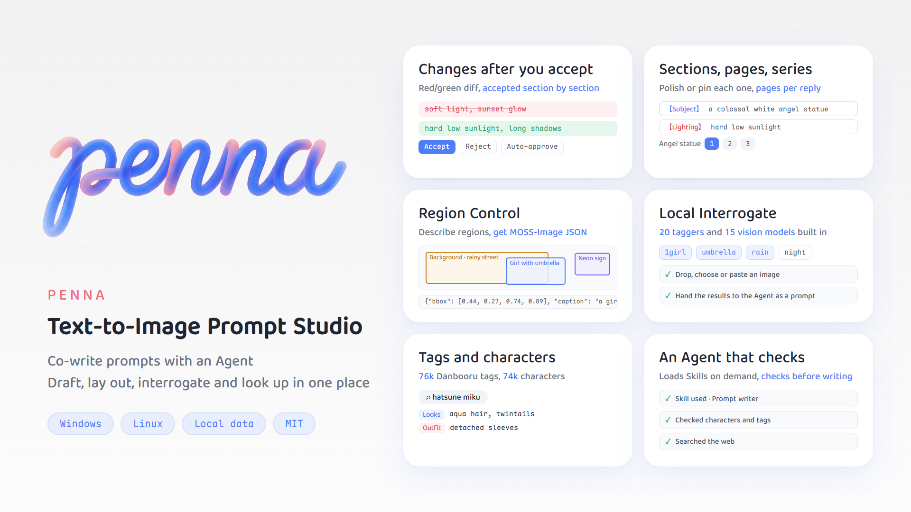

<p align="center">
  
</p>

<p align="center"><b>Penna</b> · A text-to-image prompt workbench for Windows and Linux</p>

<p align="center"><b>English</b> · <a href="README.md">简体中文</a></p>

<p align="center">
  
  
  
  
</p>

---

Penna is a tool for writing **positive prompts** for text-to-image models, covering drafting, editing, polishing and translating. The draft sits on the left and the Agent chat on the right; every change the Agent makes **is written into the draft only after you accept it**.

<p align="center">
  
</p>

## Videos (Chinese)

- [Introducing Penna](https://www.bilibili.com/video/BV1PLpj62EDu) · storyAura
- [Designing comic storyboards with Penna](https://www.bilibili.com/video/BV1yUso6AE92) · 雷昂

## Features

- **Co-writing**: Agent changes arrive as a red/green diff, accepted or rejected section by section; prompts are split into labeled sections such as 【Subject】 and 【Lighting】, across pages and series.
- **Agent chat**: conversations side by side, a side chat panel, image and file attachments, `@` Skill citations, web search and adjustable reasoning effort.
- **Region Control**: draw regions, describe each one and produce MOSS-Image layout JSON; multi-panel comic pages included.
- **Local Interrogate**: 20 built-in taggers and 15 vision models, plus online models.
- **Tags and characters**: about 76,000 Danbooru tags and 74,000 characters built in, looked up by the Agent before writing.
- **ComfyUI generation**: connects to a local or cloud ComfyUI, generates from the final prompt in one click with live progress, lets the Agent generate in chat and creates an Archive preview on save.
- **Model APIs**: OpenAI-compatible APIs, the Google API and Grok account sign-in, chained as ordered fallbacks.
- **More**: Skills, Archive, Notes, an Activity tree, MCP, four interface languages, dark mode and in-app updates.

The [feature guide](docs/features.en.md) covers everything in full. A three-page comic laid out in Penna and rendered with MOSS-Image:

<p align="center">
  
  
  
</p>

## Getting started

Download the package from [Releases](https://github.com/storyAura/Penna/releases), which also lists the changes in each version:

- **Windows 10 / 11**: `Penna-v<version>-windows-x64.zip`. Unzip it and run `penna.exe`.
- **Linux**: `Penna-v<version>-linux-x86_64.AppImage`. Run it after `chmod +x`.

On first launch the interface is in Simplified Chinese. Click the gear icon at the bottom left, open **软件设置** (App settings) and set **界面语言** (Language) to **English**. Then fill in the Base URL and API key in **Settings → API Management**. The [API setup guide](docs/api-setup.md) and the [Penna guide](docs/agent-guide.md) (in Chinese) can both be handed to an AI assistant to help with setup and first steps.

Data is stored on this PC in `Documents\Penna` (`~/Documents/Penna` on Linux) and API keys are encrypted; see [Data files](docs/features.en.md#data-files).

## Development

Requires [Flutter](https://flutter.dev) (Dart 3.13 or later):

```bash
flutter pub get
flutter run -d windows           # or -d linux
dart analyze lib test            # static analysis
flutter test                     # all tests
pwsh tool/build_release.ps1      # package for Windows; bash tool/build_release.sh for Linux
```

The code has three layers, with dependencies pointing downward: `lib/ui` (interface) → `lib/core/harness` (model calls, draft format, Skills, tags, characters, local interrogation) → `lib/data` (settings, storage, translation, encryption).

## Contributing

Please send questions and suggestions as [Issues](https://github.com/storyAura/Penna/issues).

Penna is itself a vibe-coding project, and AI-written contributions are welcome. Please test locally before submitting (at least `dart analyze lib test` and `flutter test`), and preferably branch from `dev` and open the Pull Request against `dev`.

## Acknowledgements

Every part of Penna is built on the work of the open-source community.

### Data

| Source | Used for | License |
| --- | --- | --- |
| [Danbooru](https://danbooru.donmai.us) and its taggers | The origin of all tag and character data | — |
| [Laxhar/noob-wiki](https://huggingface.co/datasets/Laxhar/noob-wiki) | Original character tag data | Apache-2.0 |
| [DanbooruSearch](https://sakizuki-danboorusearch.hf.space) | MCP service for online semantic tag search | — |

### Software and models

| Project | Used for | License |
| --- | --- | --- |
| [ONNX Runtime](https://github.com/microsoft/onnxruntime) | Running taggers locally | MIT |
| [flutter_onnxruntime](https://github.com/masicai/flutter_onnxruntime) | Flutter plugin for ONNX Runtime | MIT |
| [llama.cpp](https://github.com/ggml-org/llama.cpp) | Running GGUF vision models locally (downloaded on use) | MIT |
| [SmilingWolf WD14 Tagger](https://huggingface.co/SmilingWolf) | Local taggers (downloaded on use) | Apache-2.0 |
| [PixAI Tagger](https://huggingface.co/deepghs/pixai-tagger-v0.9-onnx), [CL Tagger](https://huggingface.co/Nonene/cl_tagger), [OppaiOracle](https://huggingface.co/Grio43/OppaiOracle) | Local taggers (downloaded on use) | See each model page |
| [Gemma 4](https://huggingface.co/unsloth/gemma-4-E4B-it-GGUF), [ToriiGate](https://huggingface.co/DraconicDragon/ToriiGate-0.5-GGUF), [JoyCaption](https://huggingface.co/concedo/llama-joycaption-beta-one-hf-llava-mmproj-gguf), [Florence-2](https://huggingface.co/onnx-community/Florence-2-base-ft) | Local vision models (downloaded on use) | See each model page |
| [lighting-kit](https://github.com/xiang6150592/-moss-prompt-editor) (provided by 韶韵, ported from MOSS Prompt Studio) | Region Control lighting assistant: lighting presets, light direction math, lighting phrases and shading preview | — |

### Fonts

| Font | Author | License |
| --- | --- | --- |
| [Maple Mono](https://github.com/subframe7536/maple-font) | subframe7536 | SIL OFL 1.1 |
| [975 Yuan](https://github.com/lxgw/975Yuan) | LXGW | SIL OFL 1.1 |

If anything is missing, or an attribution or license is wrong, please open an issue.

## License

Penna's source code is released under the [MIT](LICENSE) license.

Third-party content shipped with the app keeps its own license:

- `assets/danbooru_characters.tsv.gz`: packed from `danbooru_character_appearance_corrected.csv` in [StoryAura/Danbooru-Dataset-csv](https://huggingface.co/datasets/StoryAura/Danbooru-Dataset-csv). That table extends [Laxhar/noob-wiki](https://huggingface.co/datasets/Laxhar/noob-wiki) (Apache-2.0); the extensions are MIT and the original tags remain under Apache-2.0. The links between characters and their forms (the `base_character` column) are compiled from Danbooru tag implications and character wiki pages.
- `font/MapleMono-Regular.ttf`: SIL OFL 1.1, see [font/MapleMono-LICENSE.txt](font/MapleMono-LICENSE.txt).
- `font/LXGW975YuanSC-500W.ttf`: SIL OFL 1.1, see [font/LXGW975Yuan-LICENSE.txt](font/LXGW975Yuan-LICENSE.txt).
- `onnxruntime.dll`: [ONNX Runtime](https://github.com/microsoft/onnxruntime), MIT.
